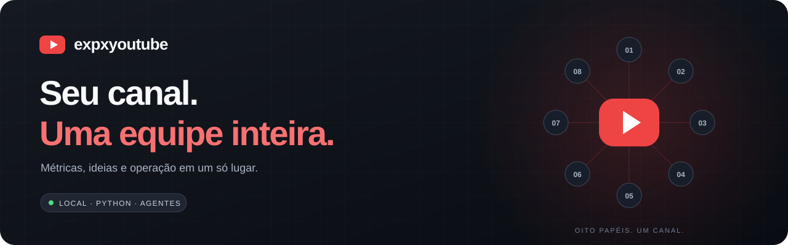
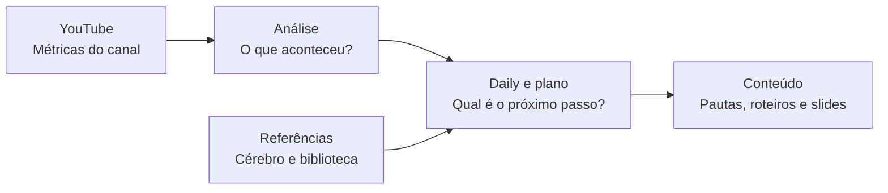

<p align="center">
  
</p>

<p align="center">
  <strong>Seu centro de operação para o YouTube, com uma equipe de oito agentes.</strong><br>
  Acompanhe os números, organize ideias e transforme decisões em próximos passos.
</p>

<p align="center">
  
  
  
  
</p>

## Instale com um comando

Abra o **Terminal** no macOS ou Linux. No Windows, abra o **Ubuntu pelo WSL**. Copie, cole e pressione Enter:

```bash
curl -fsSL https://raw.githubusercontent.com/bittencourtthulio/expxyoutube/main/install.sh | bash
```

**Pronto: o instalador prepara o projeto, o Python 3.11 e as dependências em `~/expxyoutube`.** Você precisa de conexão com a internet, Bash, `curl` e `tar`. Não precisa instalar Git ou Python antes, ativar ambiente virtual ou usar `sudo`. O instalador usa o [uv](https://docs.astral.sh/uv/getting-started/installation/) e o instala na sua conta se necessário.

Para abrir o painel:

```bash
bash ~/expxyoutube/iniciar.sh
```

O navegador abre em **[localhost:8766](http://127.0.0.1:8766)**. Para encerrar, pressione `Ctrl+C` no terminal.

> **Instalar e conectar são duas etapas.** Você já pode abrir e explorar o painel sem credenciais. Para ver os números reais do seu canal, siga [Conecte seu canal](#conecte-seu-canal). As conversas e rotinas dos agentes também precisam do Claude Code instalado e autenticado.

<p align="center">
  <a href="#o-que-você-ganha">Recursos</a> ·
  <a href="#chaves-e-configurações-o-que-cada-etapa-precisa">Chaves por etapa</a> ·
  <a href="#conecte-seu-canal">Conectar o YouTube</a> ·
  <a href="#sua-equipe-de-agentes">Equipe</a> ·
  <a href="#deixe-com-a-rotina">Automações</a> ·
  <a href="#precisa-de-ajuda">Ajuda</a>
</p>

---

## O que você ganha

| Seu trabalho | O que o expxyoutube reúne |
| :--- | :--- |
| **Entender o canal** | KPIs, evolução diária, tráfego, formatos e vídeos de destaque. |
| **Saber o que fazer agora** | Daily, quadro de tarefas, plano do dia e registro de decisões. |
| **Conversar com a equipe** | Reunião com agentes especializados, cada um com seu papel. |
| **Encontrar a próxima pauta** | Biblioteca de referências, busca por temas e ideias de conteúdo. |
| **Aprender com referências** | Cérebro de boas práticas, fontes e conhecimento conectado em grafo. |
| **Preparar a próxima aula** | Apresentações animadas, fila de pautas e validação antes do render. |
| **Organizar a operação** | Rotinas agendáveis e integrações opcionais de publicação. |

Tudo em **nove abas**: Painel, Escritório, Reunião, Tarefas, Relatórios, Decisões, Conhecimento, Grafo e Apresentações.

### Do número ao próximo vídeo



## Chaves e configurações: o que cada etapa precisa

**Você não precisa preencher tudo para começar.** O painel abre com o `.env` vazio. O instalador já cria esse arquivo na pasta do projeto; abra-o em um editor de texto e preencha apenas a etapa que vai usar. A referência completa está em [`.env.example`](.env.example).

| Etapa | Obrigatório no `.env` | Credencial ou ferramenta fora do `.env` |
| :--- | :--- | :--- |
| **1 · Abrir o painel e organizar tarefas** | Nenhuma variável. | Nenhuma conta externa para abrir a interface. |
| **2 · Coletar métricas do YouTube** | Nenhuma variável. | `client_secret.json` do Google e login com `auth.py principal`, que gera `tokens/principal.json`. |
| **3 · Conversar com os agentes e rodar a daily** | Nenhuma variável. | Claude Code instalado e autenticado. Para analisar números reais, conclua também a etapa 2. |
| **4 · Cérebro e biblioteca de referências** | Nenhuma variável. | `yt-dlp`, incluído na instalação; Claude Code para resumir e organizar referências. |
| **5 · Renderizar apresentações** | Nenhuma variável. | Node.js 20, npm e Remotion; para capturar sites, `browser-harness` é uma integração opcional. |
| **6 · Agendar Shorts** | `YT_SHORTS_SLOTS` e `YT_CANAL_ID` com o canal real. | OAuth da etapa 2, `ffmpeg` e `ffprobe`. `YT_CANAL_ALIAS` deve corresponder ao login. |
| **7 · Operar o bot do Telegram** | `TELEGRAM_YT_BOT_TOKEN`, `TELEGRAM_YT_CHATID`, `YT_SLOTS` e `YT_CANAL_ID`. | OAuth da etapa 2. Para produzir aulas, configure `CURSOS_IA_DIR` e o produtor externo compatível, além de Claude Code, Node.js, `ffmpeg`, `ffprobe` e `whisper`. |
| **8 · Produzir com avatar pelo bot** | As mesmas da etapa 7. | Acesso HeyGen via MCP/OAuth no projeto produtor. Sem essa integração disponível, o fluxo usa motion. |

O projeto não exige uma chave de API Google no `.env`: usa **OAuth**. Também não possui um campo próprio `OPENAI_API_KEY`, `ANTHROPIC_API_KEY` ou `HEYGEN_API_KEY`; autenticações de Claude Code e do produtor são configuradas nas ferramentas correspondentes.

### Quero apenas painel, métricas e agentes

**Não precisa adicionar nenhuma chave ao `.env`.** Conecte o Google seguindo a seção abaixo e autentique o Claude Code para usar os agentes. Não coloque o conteúdo do JSON do Google dentro do `.env`.

A coleta usa o apelido `principal` por padrão. Se você autenticou outro apelido, passe-o explicitamente:

```bash
.venv/bin/python editorial/analises/coletar_youtube.py --apelido meu-canal
```

`YT_CANAL_ALIAS` configura bot e Shorts; ele não altera automaticamente o apelido do coletor.

### Quero agendar Shorts

Preencha no `.env`:

```dotenv
YT_CANAL_ALIAS=principal
YT_CANAL_ID=COLE_O_ID_REAL_DO_SEU_CANAL
YT_SHORTS_SLOTS=09:00,18:00
YT_SHORTS_DIR=~/meus-shorts
```

- **ID do canal:** copie o ID mostrado por `.venv/bin/python auth.py principal`.
- **Horários:** use `HH:MM`, separados por vírgula, no fuso `America/Sao_Paulo`.
- **Pasta:** cada vídeo precisa de uma subpasta com o mesmo nome do MP4 e um `legenda.txt`: `meu-video/meu-video.mp4` e `meu-video/legenda.txt`. Se `YT_SHORTS_DIR` ficar vazio, o padrão é `midias/shorts/` dentro do projeto.
- **Telegram:** não é necessário para os Shorts.

Confira o plano **sem enviar vídeo**:

```bash
.venv/bin/python shorts.py agendar --simular
```

### Quero usar o bot do Telegram

Preencha no `.env`:

```dotenv
TELEGRAM_YT_BOT_TOKEN=COLE_O_TOKEN_DO_SEU_BOT
TELEGRAM_YT_CHATID=COLE_O_ID_NUMERICO_DO_SEU_CHAT
YT_CANAL_ALIAS=principal
YT_CANAL_ID=COLE_O_ID_REAL_DO_SEU_CANAL
YT_SLOTS=10:00,16:00
CURSOS_IA_DIR=~/caminho/do/produtor-compativel
```

| Campo | Como obter |
| :--- | :--- |
| `TELEGRAM_YT_BOT_TOKEN` | No Telegram, converse com [@BotFather](https://t.me/BotFather), envie `/newbot` e siga as instruções. Veja o [tutorial oficial](https://core.telegram.org/bots/tutorial#obtain-your-bot-token). |
| `TELEGRAM_YT_CHATID` | Envie uma mensagem ao seu novo bot e leia `message.chat.id` na resposta de [`getUpdates`](https://core.telegram.org/bots/api#getupdates). Use o número do chat que poderá controlar o bot. |
| `YT_CANAL_ALIAS` | O apelido usado no login OAuth; normalmente `principal`. |
| `YT_CANAL_ID` | O ID exibido após o login com `auth.py`, começando com `UC`. Não use o `@handle`. |
| `YT_SLOTS` | Escolha os horários das aulas no formato `10:00,16:00`, no fuso `America/Sao_Paulo`. |
| `CURSOS_IA_DIR` | Caminho da sua instalação de um produtor compatível. Esse projeto externo não acompanha o expxyoutube; só preencher o caminho não instala a integração. |

Para descobrir o ID sem colocar seu token na linha de comando: preencha **somente o token** no `.env`, envie uma mensagem ao seu bot e rode o trecho abaixo na pasta do projeto, com o bot parado. Ele mostra apenas os IDs e os nomes dos chats recebidos:

```bash
.venv/bin/python - <<'PY'
from bot_youtube.config import ARQUIVO_CHAVES, ler_arquivo
from bot_youtube.telegram import Telegram

chaves = ler_arquivo(ARQUIVO_CHAVES)
token = chaves.get("TELEGRAM_YT_BOT_TOKEN", "")
if not token:
    raise SystemExit("Preencha TELEGRAM_YT_BOT_TOKEN no .env primeiro.")
updates = Telegram(token).chamar("getUpdates")
for update in updates:
    chat = (update.get("message") or {}).get("chat") or {}
    if chat:
        print(chat["id"], chat.get("title") or chat.get("first_name") or "chat")
if not updates:
    print("Envie uma mensagem ao seu bot e execute novamente.")
PY
```

Depois de preencher os demais campos e conectar o canal, confira token, identidade do bot, horários e canal **sem publicar**:

```bash
.venv/bin/python bot_youtube.py verificar
```

### Ajustes opcionais

| Variável no `.env` | Padrão | Para que serve |
| :--- | :--- | :--- |
| `YT_ANTECEDENCIA_MIN` | `90` | Antecedência mínima para reservar um horário; usado por bot e Shorts. |
| `YT_TEMPO_PRODUCAO_MIN` | `240` | Tempo máximo, em minutos, para a produção de uma aula pelo bot. |
| `YT_DISCO_MIN_GB` | `8` | Espaço livre mínimo para o bot iniciar a produção. |
| `YT_COTA_DIA` | `10000` | Limite de cota que o agendador de Shorts considera. Não aumenta a cota concedida pelo Google. |
| `TELEGRAM_API_BASE` | `https://api.telegram.org` | Endpoint da Bot API; mantenha o padrão no uso normal. |

**Como a configuração é lida:** bot e Shorts leem automaticamente o `.env`. Se a mesma variável existir no ambiente do processo, ela tem prioridade. O leitor aceita `NOME=valor` e comentários em linhas próprias; não expande `$HOME` ou `${OUTRA_VARIAVEL}`. Para diretórios, use um caminho absoluto ou `~/pasta`.

Já os ajustes avançados abaixo são lidos **do ambiente do terminal**, e não automaticamente do `.env`:

| Variável no terminal | Uso |
| :--- | :--- |
| `YT_CHAT_MODELO` | Troca o modelo do chat; padrão `sonnet`. |
| `CLAUDE_BIN` | Caminho do executável Claude Code; padrão `claude`. |
| `APRESENTACAO_NODE` / `APRESENTACAO_NPM` | Caminhos dos executáveis de Node.js e npm. |
| `APRESENTACAO_BH` | Caminho de `browser-harness`, para capturas de sites. |

Por exemplo, para definir o modelo do chat ao abrir o painel:

```bash
YT_CHAT_MODELO=sonnet bash iniciar.sh
```

## Conecte seu canal

Essa configuração é feita **uma vez por instalação**, usando sua própria conta Google. O projeto vem sem tokens, canais cadastrados ou dados de terceiros.

### 1. Crie a credencial do Google

1. Abra o [Google Cloud Console](https://console.cloud.google.com/) e crie ou selecione um projeto.
2. Na biblioteca de APIs, ative **YouTube Data API v3** e **YouTube Analytics API**.
3. Configure a tela de consentimento OAuth. Se o aplicativo estiver em teste, adicione sua conta Google como usuário de teste.
4. Crie um **ID do cliente OAuth** com o tipo **App para computador**.
5. Baixe o JSON, renomeie para **`client_secret.json`** e coloque dentro de `~/expxyoutube`.

Consulte o [guia oficial de autorização para aplicativos desktop](https://developers.google.com/youtube/data/guides/auth/installed-apps) se precisar de detalhes da configuração do Google.

### 2. Autorize o acesso

```bash
cd ~/expxyoutube
.venv/bin/python auth.py principal
```

O navegador abre o login. Escolha a conta e o canal corretos e confira as permissões solicitadas: o cliente também oferece recursos de publicação. Ao concluir, o terminal mostra o nome e o ID do canal. O token fica guardado localmente em `tokens/`.

### 3. Traga os primeiros números

Ainda na pasta do projeto:

```bash
.venv/bin/python editorial/analises/coletar_youtube.py
.venv/bin/python editorial/analises/diagnostico.py
bash iniciar.sh
```

A coleta consulta as APIs; as métricas disponíveis dependem dos dados que o YouTube disponibilizar para o canal e o período.

## Sua equipe de agentes

| Agente | Papel na operação |
| :--- | :--- |
| **Planejador** | Conduz a daily e organiza o plano do dia. |
| **Analista** | Lê as métricas e transforma dados em diagnóstico. |
| **Roteirista** | Prepara títulos, miniaturas, ganchos e roteiros. |
| **Curador** | Organiza as referências de boas práticas do YouTube. |
| **Bibliotecário** | Encontra fontes e ideias para novas pautas. |
| **Reviewer** | Revisa o trabalho com acesso de leitura. |
| **Apresentador** | Monta os slides animados das aulas. |
| **Validador** | Avalia as pautas e os decks antes do render. |

Os agentes usam o **Claude Code**, que precisa estar instalado e autenticado na máquina. A instalação do expxyoutube prepara a aplicação Python; sua conta e o acesso ao Claude são configurados separadamente.

Personalize estes três arquivos antes de pedir conteúdo à equipe:

| Arquivo | O que colocar |
| :--- | :--- |
| [`editorial/voz.md`](editorial/voz.md) | Seu público, seu tom de voz e seus exemplos. |
| [`editorial/cadencia.md`](editorial/cadencia.md) | Sua capacidade e frequência de publicação. |
| [`editorial/aprendizados.md`](editorial/aprendizados.md) | O que você já observou no seu próprio canal. |

### Comandos para começar

Execute na pasta do projeto:

```bash
# Veja o que está pendente
.venv/bin/python daily.py pendentes

# Monte o plano do dia
.venv/bin/python planejar.py criar

# Converse com um especialista — requer Claude Code
.venv/bin/python chat.py dizer "O que os números mostram esta semana?" --para analista

# Confira uma fonte antes de cadastrar
.venv/bin/python cerebro.py canal add https://www.youtube.com/@canal --previa

# Busque ideias nas fontes que você já importou
.venv/bin/python biblioteca.py buscar --tema agentes --ideias
```

As bases começam vazias. Cadastre suas fontes e adapte `temas.json` e `descoberta.json` dentro de `cerebro/` e `biblioteca/` ao território do seu canal.

## Apresentações que acompanham a aula

Use **`/apresentacao`** para preparar um deck e **`/pautas`** para trabalhar a fila de ideias no Claude Code. O validador avalia o material antes de liberar o render.

```bash
.venv/bin/python apresentacao.py lista
.venv/bin/python apresentacao.py render <slug>
```

O render usa **Node.js 20**, npm e Remotion, instalados separadamente. Os decks ficam em `apresentacoes/decks/`; o motor de slides está em `apresentacoes/motion/`. Confira a [licença do Remotion](https://www.remotion.dev/docs/license) para o seu uso. O CTA inicial usa `example.com`: troque pelo seu site antes de produzir material final.

## Deixe com a rotina

Depois de configurar o canal e o Claude Code, você pode executar a rotina manualmente:

```bash
./rotina.sh manha
```

Ela reúne coleta, diagnóstico e planejamento. Nenhum cron ou serviço é instalado pelo comando de instalação.

<details>
<summary><strong>Quero agendar as rotinas automaticamente</strong></summary>

Autorize a automação na sua instalação e adicione os horários com `crontab -e`. Substitua `/caminho/do/projeto` pelo caminho real da pasta instalada:

```cron
30 6 * * * /caminho/do/projeto/rotina.sh manha
0 4 * * * /caminho/do/projeto/rotina.sh cerebro-atualizar
0 3 * * * /caminho/do/projeto/rotina.sh biblioteca-atualizar
0 9 * * 1 /caminho/do/projeto/rotina.sh biblioteca-descobrir
0 9 * * 4 /caminho/do/projeto/rotina.sh cerebro-descobrir
```

Os logs ficam em `planejamento/logs/`.

</details>

<details>
<summary><strong>Quero usar Telegram, Shorts ou publicação</strong></summary>

O instalador cria o arquivo privado `.env` a partir de [`.env.example`](.env.example). Preencha apenas as opções das integrações que você pretende usar:

| Variável | Uso |
| :--- | :--- |
| `TELEGRAM_YT_BOT_TOKEN` | Token do seu bot do Telegram. |
| `TELEGRAM_YT_CHATID` | ID do chat autorizado. |
| `YT_CANAL_ALIAS` / `YT_CANAL_ID` | Apelido OAuth e ID do canal de destino. |
| `YT_SLOTS` / `YT_SHORTS_SLOTS` | Horários de publicação. |
| `YT_SHORTS_DIR` | Pasta dos seus vídeos curtos. |
| `CURSOS_IA_DIR` | Caminho de uma instalação externa compatível com a produção de aulas. |

A produção de aulas do bot depende de um projeto externo compatível, **não incluído neste repositório**. Consulte a [integração com produtor](docs/integracao-produtor.md). Configure, confira o destino e autorize a automação antes de ativar o envio. Para desativar o serviço, consulte [como desfazer](docs/DESFAZER.md).

</details>

## Seus dados ficam na sua instalação

A versão pública contém o código e configurações de exemplo. Suas credenciais, tokens, métricas, históricos, mídias e planejamentos ficam em arquivos locais ignorados pelo Git. O painel escuta em `127.0.0.1`.

As integrações acessam serviços externos quando você as usa: APIs do Google para o canal, Claude para os agentes e Telegram para o bot. Dados usados nessas operações podem ser enviados ao serviço correspondente.

## Precisa de ajuda?

| Situação | Como resolver |
| :--- | :--- |
| **Estou no Windows** | Execute o comando no Ubuntu do WSL. O PowerShell nativo não é suportado pelo aplicativo. |
| **A pasta já existe** | A instalação para sem alterar arquivos. Abra com `bash ~/expxyoutube/iniciar.sh` ou escolha outro destino abaixo. |
| **O painel está sem métricas** | Conecte o canal e execute a coleta e o diagnóstico. |
| **A porta está ocupada** | Execute `bash ~/expxyoutube/iniciar.sh --porta 8767`. |
| **Os agentes não respondem** | Confira se o comando `claude` está disponível e autenticado no seu terminal. |
| **O Google recusou o login** | Confira as APIs, o tipo de credencial e os usuários de teste no projeto Google Cloud. |
| **O render de slides falhou** | Confira Node.js 20, npm e a mensagem emitida pelo `apresentacao.py`. |

<details>
<summary><strong>Instalar em outra pasta</strong></summary>

```bash
curl -fsSL https://raw.githubusercontent.com/bittencourtthulio/expxyoutube/main/install.sh | EXPXYOUTUBE_DIR="$HOME/meu-youtube" bash
```

Abra depois com `bash ~/meu-youtube/iniciar.sh`. Os demais exemplos deste README usam o destino padrão `~/expxyoutube`; ajuste o caminho se escolher outro.

</details>

<details>
<summary><strong>Instalação manual para quem prefere Git</strong></summary>

Requer Git e Python 3.11 ou superior, com suporte a `venv`:

```bash
git clone https://github.com/bittencourtthulio/expxyoutube.git
cd expxyoutube
python3 -m venv .venv
.venv/bin/python -m pip install -r requirements.txt
cp .env.example .env
.venv/bin/python painel.py
```

O instalador de um comando baixa um arquivo do código, sem histórico Git. Para contribuir ou acompanhar mudanças com Git, prefira esta opção.

</details>

<details>
<summary><strong>Estrutura do projeto e testes</strong></summary>

```text
expxyoutube/
├── install.sh / iniciar.sh   instalação e abertura do painel
├── painel/                  interface web e escritório 3D
├── .claude/                 agentes, comandos, regras e hooks
├── editorial/               voz, cadência e análise do canal
├── cerebro/                 referências de boas práticas
├── biblioteca/              fontes e ideias de conteúdo
├── apresentacoes/           decks e motor de slides
├── bot_youtube/             integração opcional com Telegram
├── tests/                   suíte com bloqueio de rede externa
└── .env.example             modelo de configuração local
```

Execute os testes na pasta do projeto:

```bash
.venv/bin/python -m pytest -q
```

O ambiente instalado pelo uv não precisa de ativação: os comandos apontam diretamente para `.venv/bin/python`.

</details>

---

<p align="center"><strong>Menos abas espalhadas. Mais clareza sobre o próximo vídeo.</strong></p>
